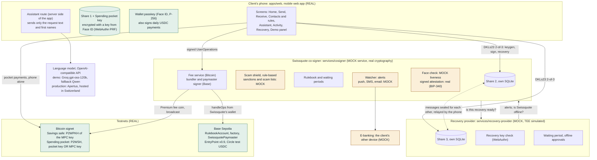
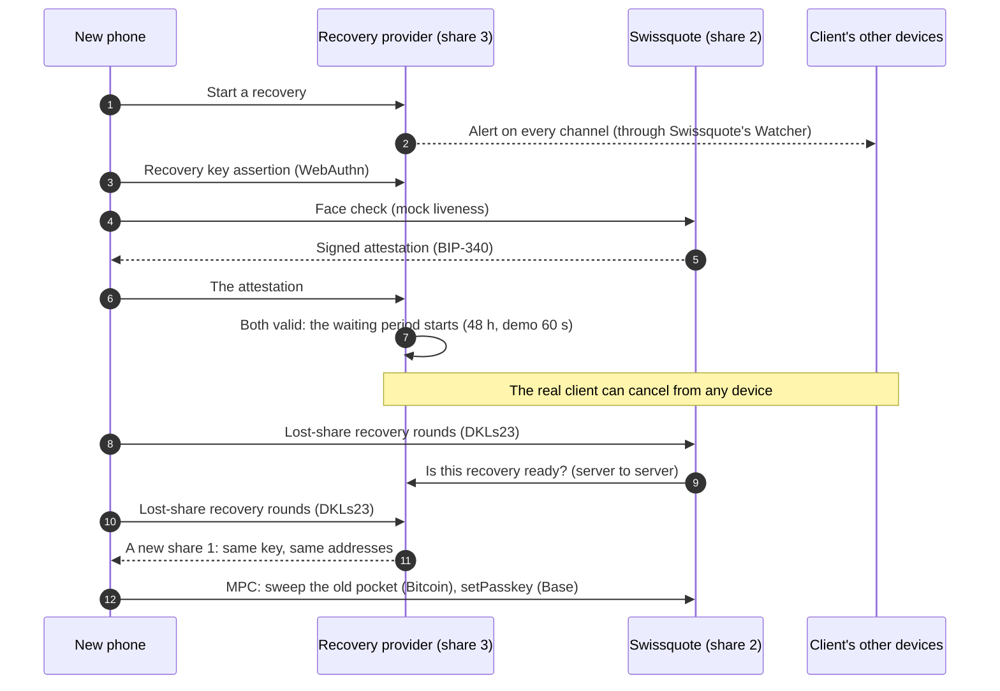

# Swissquote Wallet — hackathon prototype

A self-custody wallet Swissquote could launch for its clients: **their keys, their control, one step away from
their Swissquote account.** Built for the Swissquote Wallet Challenge (EPFL, October 2026).

> **Status: the core story works end to end on testnets** (open a safe, pay, lose the phone, recover), with
> bitcoin on signet and digital dollars (USDC) on Base Sepolia, an attacker mode, a "Swissquote offline" mode,
> gasless payments and a payment assistant. Every payment shown is a real transaction. Spec: [`CLAUDE.md`](CLAUDE.md).
> Demo: [`docs/demo-script.md`](docs/demo-script.md).

## The idea

Swissquote's clients, many of them older and new to crypto, want to own bitcoin and digital dollars without
facing the crypto world alone. So the wallet feels like Twint (Face ID is the only password, people are
contacts, never addresses, no seed phrase ever) and Swissquote's protection is visible at every step.

**One key, three pieces.** The key is created already split into three MPC shares: one on the client's phone
(unlocked by Face ID), one at Swissquote, one at an independent recovery provider. Any two sign; **Swissquote
alone can never move the funds.**

**Swissquote signs the rulebook, not every payment.** The client's rules (approved contacts, a daily limit, a
small Spending pocket) let the phone pay family and friends alone. Anything outside the rules needs
Swissquote's co-signature after its scam shield. Loosening a rule waits 24 hours, with alerts; tightening is
instant.

**Lose the phone, keep the safe.** A separate recovery key, Swissquote's face check and a waiting period give
the client a new piece of the same key on a new phone; the lost phone's piece becomes useless. **If Swissquote
disappears**, the phone and the recovery provider still move everything.

## The demo in five acts

| Act | What the jury sees | Real on-chain |
|---|---|---|
| 1. Open a safe | Face ID, three key holders light up, recovery key, plan, "verified by Swissquote" | ownership proofs (BIP-322, ERC-1271) |
| 2. Pay like Twint | pocket payment with Face ID only; "Send 2 USDC to my son" with the assistant; a Savings payment with Swissquote's check | signet and Base transactions |
| 3. Attacker mode | a thief with the unlocked phone and the email: CHF 5,000 stopped, new contact on hold and cancelled, recovery refused | — |
| 4. Swissquote is gone | pocket still works; the Savings safe moves with the recovery key and the independent provider | signet transaction without Swissquote |
| 5. Lose the phone | recovery on a new phone after the waiting period; same addresses; old Face ID dead on Base | sweep and `setPasskey` |

Step by step, with what to say and the fallbacks: [`docs/demo-script.md`](docs/demo-script.md).

## Architecture



Each key holder is a **separate process with its own database**; the phone never holds their shares. The
browser reaches both services through the web app's origin (`/svc/cosigner`, `/svc/recovery`), a plain proxy.

| Path | What it is |
|---|---|
| `apps/web` | Next.js mobile-first web app (the phone), including the assistant's server route |
| `services/cosigner` | Swissquote co-signer (**mock**): share 2, scam shield, rulebook delays, fees, bundler and paymaster, face check, alerts |
| `services/recovery-provider` | Independent recovery provider (**mock**, TEE simulated): share 3, recovery key, waiting period |
| `contracts` | Foundry: `RulebookAccount`, its factory and `SwissquotePaymaster` (Base Sepolia) |
| `packages/mpc` | 2-of-3 threshold ECDSA (DKLs23): keygen, sign, refresh, lost-share recovery, networked protocol |
| `packages/bitcoin` | Savings safe and Spending pocket scripts, payments, refills, fee sponsoring, BIP-322 |
| `packages/ethereum` | Account settings and address, UserOperations, call encoding, passkey and MPC signatures, ERC-1271/6492 |
| `packages/shared` | Types, service contracts, rulebook and Merkle helpers, payment assistant rules |
| `spikes/m0-mpc` | M0 spike and live end-to-end checks (`m2-check`, `m3-check`, `m4-check`) |
| `docs` | The demo script, and the team's prompts and approved spec elements |

## Custody model

| Share | Holder | Protection |
|---|---|---|
| 1 | The client's phone | Encrypted in the browser; the key comes from the wallet passkey (Face ID, WebAuthn PRF) |
| 2 | Swissquote's co-signer | Its own process and database (an HSM in production) |
| 3 | The independent recovery provider | Its own process and database (a TEE in production) |

The **same 2-of-3 key** holds the Savings safe (Bitcoin) and controls the USDC account on Base.

| Who signs | When | What stops abuse |
|---|---|---|
| Phone alone | Everyday: the Spending pocket (bitcoin); USDC to approved contacts | Bitcoin: the pocket's balance (default CHF 100). Base: the account checks the contact's Merkle proof and the daily limit **on-chain** |
| Phone + Swissquote | Larger payments, refills, rule changes, new passkey after recovery | Swissquote's scam shield, its own CHF values, waiting periods on loosening changes |
| Phone + recovery provider | Swissquote is gone | The provider checks that Swissquote is down and that the client approved this exact payment with the **recovery key** |
| Swissquote + recovery provider | Recovery only: a new share 1 | Recovery key assertion **and** Swissquote's face-check attestation, then a waiting period with alerts; the real client can cancel |

## Threat model

| Who | Can they steal? | Can they lock the client out? | Why |
|---|---|---|---|
| A thief with the **unlocked phone and the client's email** | At most the Spending pocket (≤ CHF 100 of bitcoin) and USDC to the client's own contacts within the daily limit | No | New recipients and large amounts need Swissquote's check (blocked); adding a contact waits 24 h and alerts every channel; recovery needs the recovery key and the face check |
| **Swissquote alone** (or an attacker inside it) | No: one share of three | Only partly: it can refuse to co-sign, but phone + recovery provider still move the bitcoin. In this prototype USDC payments wait for Swissquote's relay (see M4) | 2-of-3. The phone verifies what Swissquote prepares before signing (same transaction, same digest, contacts it showed) |
| **The recovery provider alone** | No | No | Phone + Swissquote keep working |
| **Swissquote and the provider together** | Technically yes: any two shares sign | — | This is the trust assumption. The provider is an independent company, and in production its TEE releases nothing without a valid recovery-key assertion and a face-check attestation. A recovery always waits 48 h with alerts the client can act on. In the prototype these checks are software |
| A **stolen recovery key** | No, alone | No | It also needs Swissquote's face check and survives a waiting period with alerts |
| **Malware on the phone** that gets past Face ID | As the thief above: what the phone can do alone | No | Swissquote recomputes amounts, values and fees from the network and its own price before co-signing; the account on Base enforces the rules itself |
| **The language model** (or a prompt injection) | No | No | It only drafts. It never sees an address, an identity or a key; rules decide; Face ID confirms |
| The client loses **the phone and the recovery key** | — | Yes, by design | Nobody can recover without the recovery key. The synced-passkey option trades safety for convenience, with a warning |

**Can Swissquote move a client's funds alone?** No. **With a partner?** Only together with the independent
recovery provider. That is the recovery path, guarded by the client's recovery key, a face check, a waiting
period and alerts, and in production by the provider's TEE. Picking that provider (contract, jurisdiction,
audit) is part of the launch.

## Custody, the Travel Rule and legal points

- **Ownership proof instead of whitelists and screenshots.** At creation the safe signs a message binding it to
  the client's Swissquote client number: **BIP-322** for the Savings safe, **ERC-1271** for the Base account
  (ERC-6492 before its first transaction). Swissquote verifies them and marks the safe "verified". For
  transfers between the client's Swissquote account and the wallet, this is how Swissquote knows the
  self-hosted wallet belongs to its client, as FINMA expects for transfers with self-hosted wallets
  (Guidance 02/2019). *To verify with counsel.*
- **Who sends a payment to a third party?** The client, with their own keys. On the everyday path Swissquote
  does not authorize the payment (on Premium it only pays the network fee); on the Savings path it co-signs
  after its checks but does not initiate. Our reading is
  that Swissquote is not the sending institution for client-to-third-party payments. *Flagged: to verify
  legally,* including whether a 1-of-3 co-signer counts as a custodian under Swiss law.
- **Scam shield and sanctions.** Recipients are screened when they are added (where scams happen) and on every
  payment outside the rules. The lists here are mocks; production would use a screening provider.
- **Data protection.** The assistant's model never receives the client's identity, only the request text and
  contacts' first names. In production Apertus runs in Switzerland (self-hosted or a Swiss sovereign cloud).
- **Licences.** DKLs23 (Silence Laboratories) is source-available under a *non-commercial* licence: fine for a
  prototype; a launch needs a commercial licence or another library behind the same `@sqw/mpc` API. Everything
  else is open source (OpenZeppelin, bitcoinjs-lib, noble, viem, SimpleWebAuthn).

## Business model

| | **Premium** | **Standard** |
|---|---|---|
| Client pays | A subscription for the MPC key and the recovery service | Nothing for the wallet |
| Network fees | **Absorbed by Swissquote**: on Base its paymaster pays the gas; on Bitcoin its fee service adds a coin of its own | Paid by the client: from their own bitcoin, or in USDC through the paymaster (never ETH) |
| Abuse cap | Per client and day: 5,000 sats of Bitcoin fees, 50 Base operations | — |

Why it works for Swissquote: crypto-curious clients stay inside Swissquote (transfers from and to their
Swissquote account, trading, advice) instead of leaving for an exchange; recovery is a service people pay for;
and Swissquote never holds the keys alone. What we measured: a Base operation costs Swissquote 0.000001 to 0.000002
ETH of test gas (fractions of a centime at today's prices); Bitcoin fees depend on the network and stay under the daily cap. The subscription
price is still to be set.

## Bonus topics

- **Gasless, done.** Premium: the paymaster on Base and a fee coin on Bitcoin, both signed by Swissquote only
  after checking the exact transaction. Standard: fees in USDC, so the client never needs ETH.
- **Compliant dApp interaction, not built.** The account already accepts any batch of calls signed with the MPC
  key after Swissquote's checks, so a dApp flow would go through the same scam shield (allowlisted contracts).
- **Also built:** the payment assistant (text or voice, four languages), the "Swissquote offline" path guarded
  by the recovery key, the attacker mode, and the rulebook enforced on-chain on Base.

## Real vs mock

| Component | Status |
|---|---|
| MPC 2-of-3 threshold signatures | Real (DKLs23) |
| Swissquote co-signer | Mock (separate process) |
| Recovery provider / TEE | Mock (separate process; TEE simulated) |
| Recovery key (second passkey) | Real (WebAuthn, verified with @simplewebauthn/server) |
| KYC and face check | Mock (simulated liveness; Swissquote's signed attestation is real) |
| Alert channels (push, SMS, email) | Mock (shown in the app and a mock e-banking page) |
| Sanctions and known-scam lists | Mock (labelled in the app) |
| Swissquote fee wallet (Premium) | Real signet coins; key in the co-signer's database (Mock HSM) |
| Wallet passkey (Face ID) | Real (WebAuthn with PRF) |
| Swissquote login | Mock (client already verified) |
| Family contacts | Demo data (Mock), as if imported from Swissquote |
| BTC, ETH and USDC prices in CHF | Real (CoinGecko), fixed demo prices if unavailable (labelled) |
| Bitcoin signet transactions | Real |
| Base Sepolia transactions | Real |
| Rulebook smart account, factory, paymaster | Real contracts on Base Sepolia (verified source) |
| Bundler and paymaster signer | Real ERC-4337 operations, run by Swissquote's mock service; key in its database (Mock HSM) |
| Test USDC | Circle's test USDC on Base Sepolia |
| Payment assistant model | Real: gpt-oss-120b on Groq for the demo (fallback Qwen); Apertus, the intended Swiss model, is one setting away (Mock of the Swiss-hosted deployment) |
| Speech-to-text | Mock (the browser's speech recognition, standing in for a Swiss-hosted service) |

## AI tools used

- **Claude Code** (Anthropic, Claude Opus) wrote most of the code, milestone by milestone, from the team's
  spec in [`CLAUDE.md`](CLAUDE.md): it checked library versions online, ran the testnet checks, and asked
  before deviating from the spec. The team wrote the spec, decided the deviations (OpenZeppelin `Account`
  instead of Safe or Kernel; Swissquote's own bundler and paymaster; Groq standing in for Apertus while the
  Apertus accounts had no credit), and tested every milestone by hand in the browser.
- **In the product:** a language model only turns a payment request into a structured draft (Planner and
  model switch adapted from the team's earlier project Orchestra). It never approves, blocks or signs
  anything; deterministic rules decide. The scam shield is rule-based, not AI.

## Running it

Requirements: Node.js 22.13 or later, pnpm 10. Optional: Foundry for the Solidity tests.

```bash
cp .env.example .env      # then add LLM_API_KEY for the assistant (see the comments)
pnpm install
pnpm dev                  # web app (3000), co-signer (4001), recovery provider (4002)
pnpm test                 # TypeScript tests
pnpm test:contracts       # Solidity tests: Foundry, and `pnpm --filter @sqw/contracts setup` once
```

Open http://localhost:3000 in Chrome, Edge or Safari. Face ID uses passkeys (WebAuthn), which need `localhost`
or https. On a real phone on the same network: `pnpm --filter @sqw/web dev:https` and set `DEV_ORIGINS` in
`.env` to your computer's IP address.

**Test coins for a demo** (Plan and settings shows Swissquote's demo account): fund its Bitcoin address from a
signet faucet the day before (faucet coins need a block), its Base address with test USDC from
faucet.circle.com, and the paymaster with `pnpm --filter @sqw/cosigner fund:paymaster`. The demo family's
wallets are mock wallets: Swissquote collects what they receive every 10 minutes, so coins keep circulating.

Live checks against the running services: `pnpm --filter @sqw/spike-m0-mpc m2-check` (Savings safe, refills),
`m3-check` (rulebook, attacker, face check) and `m4-check` (Base: Face ID payment, rules on-chain, refusals).

---

## Technical details and evidence, by milestone

### M0: real MPC, no MockMPC

We use **Silence Laboratories DKLs23** (`@silencelaboratories/dkls-wasm-ll-node` 1.2.0) through
[`packages/mpc`](packages/mpc). It gives 2-of-3 distributed key generation, signing by any two holders,
proactive refresh and lost-share recovery, which is exactly the recovery step of the core story.

| Chain | Signed by | Transaction |
|---|---|---|
| Bitcoin signet | phone + Swissquote | [`1f38dfcd…92aec2`](https://mempool.space/signet/tx/1f38dfcd88fc34b07121f8f97dbce613d69a3073da6dcf6c289070195192aec2) |
| Base Sepolia | phone + recovery provider (Swissquote offline) | [`0x1dabbe…57a9c9`](https://sepolia.basescan.org/tx/0x1dabbed9cfe3524a57be0fcb4ac319d27acb1a0ae36503f6a10c43343957a9c9) |

Licence caveat: see [Custody, the Travel Rule and legal points](#custody-the-travel-rule-and-legal-points) and
[`packages/mpc/README.md`](packages/mpc/README.md).

### M1: Bitcoin core

**Create the safe.** Face ID creates the *wallet passkey* (WebAuthn, P-256). Its PRF extension turns each
Face ID check into a secret from which the phone derives the AES key that encrypts share 1 and the pocket
key in the browser's storage. The phone then runs DKLs23 key generation (WASM in the browser) with the
co-signer and the recovery provider over HTTP; each keeps only its share in its own database. The two
services seal the messages they send each other (NaCl box), so the phone relays them without being able
to read or alter them. Each service fetches the other's sealing key directly, never through the phone.

| | Script | Who can spend |
|---|---|---|
| Savings safe | P2WPKH of the MPC key | any 2 of 3 (phone, Swissquote, recovery provider) |
| Spending pocket | P2WSH `IF <pocket key> ELSE <MPC key> ENDIF CHECKSIG` | the phone alone (Face ID), **or** the MPC key |

The pocket key never leaves the phone and is never copied or escrowed. If the phone is lost, the 2-of-3
MPC key sweeps the pocket into a new one, so recovery restores the Savings safe *and* the Spending pocket.
Bitcoin script cannot limit amounts or recipients, so the pocket's balance is the limit.

| What | Transaction |
|---|---|
| Pocket payment from the app (Face ID, pocket key only) | [`1b81d0e4…607cfa`](https://mempool.space/signet/tx/1b81d0e47c7f2a2ba119e4f0e3ca3eb3dea919b074912ce4f7701e661a607cfa) |
| Pocket script, pocket-key branch (`pnpm pocket-check spend`) | [`56cc1955…d2b9f1`](https://mempool.space/signet/tx/56cc1955a15ba9873ce4d85397704869ad85be7bca1debfdeca6450883d2b9f1) |
| Pocket script, MPC branch: the recovery sweep | [`16f68f78…a152c4`](https://mempool.space/signet/tx/16f68f7865c8cf7e46848778fac1e0d053956a33cf860297921f61fe2fa152c4) |

**Prototype limitations.** A web app cannot force a passkey to stay on one device: Apple and Google may
sync it. The phone's encrypted share still lives only in that browser's storage. A native app would use a
device-bound Secure Enclave / StrongBox key. Browsers without PRF fall back to a non-extractable device key,
with Face ID gating each use; the app says so when it happens.

### M2: services and the Savings safe

Everything that moves the Savings safe is signed by the phone **and** a second key holder, and each holder
decides for itself what it signs:

1. The phone asks Swissquote to co-sign one input of a transaction (`POST /mpc/sign` with the PSBT).
2. Swissquote rebuilds the transaction, takes every input's value from the Bitcoin network (never from
   the app), recomputes CHF values at its own price, and runs its rules: coins must come from the client's
   Savings safe, a refill must go to the client's registered pocket and not overfill it, the fee must be
   sane, and the **scam shield** judges the recipient (`APPROVE` / `NEEDS_CONFIRMATION` / `BLOCKED`).
3. Swissquote computes the digest itself and returns it; the phone compares it with its own and stops if
   they differ. Only then do both run DKLs23 signing. Each pre-signature is used once.

| Scam shield rule (rule-based, no AI) | Verdict |
|---|---|
| Approved contact, within the CHF 100 daily limit | APPROVE |
| Approved contact, above the daily limit | NEEDS_CONFIRMATION (extra tap on the card) |
| First-time recipient, within the limit | NEEDS_CONFIRMATION, scam warning |
| First-time recipient, above the limit (attacker mode: CHF 5,000 to the thief) | BLOCKED |
| Sanctioned or reported scam address (mock lists) | BLOCKED |
| Frozen safe | BLOCKED |

**Pocket refill.** After a payment leaves the Spending pocket below half of its size, the same Face ID
check refills it from the Savings safe (phone + Swissquote), up to CHF 100.

**Ownership proof.** The Savings safe signs a BIP-322 message binding it to the client's Swissquote client
number (phone + Swissquote, with `bip322-js`). Registration is write-once, so the refill destination cannot be
redirected later.

**Plans and fees.** On **Standard** the client pays the network fee from their own bitcoin. On **Premium**,
Swissquote's fee service adds one coin of its own: the client's coins cover exactly the amount, Swissquote's
coin covers the fee, and both sign the same final transaction. Swissquote signs its coin only if it pays
nothing but the fee, at most 1.5× the rate it offered, within the daily cap. If it cannot sponsor, the client
pays and the card says why.

| What | Signed by | Transaction |
|---|---|---|
| Automatic pocket refill from the Savings safe | phone + Swissquote (MPC) | [`db910505…`](https://mempool.space/signet/tx/db910505152cd25c73ff30577b341eafada1c459f5c4066c4b253b57b9d20cc5) |
| Payment to Sofia from the Savings safe | phone + Swissquote (MPC) | [`911728a3…`](https://mempool.space/signet/tx/911728a306379580ff63b8e8a9a654d458351effb3d46ba00943622b1478749f) |
| Payment to Léo above the daily limit (client confirmed the extra step) | phone + Swissquote (MPC) | [`d6d6920b…`](https://mempool.space/signet/tx/d6d6920b893f410d96fa70a429adf9c25132f21303bc7b82df8edc681ccdea77) |
| Automatic refill right after it | phone + Swissquote (MPC) | [`fd22de9c…`](https://mempool.space/signet/tx/fd22de9c82db3da7dd509440f486a68844eb96ca6217842499043b4a1ae99df2) |
| Premium: pocket payment, network fee paid by Swissquote's coin | pocket key + Swissquote's fee coin | [`618856cf…`](https://mempool.space/signet/tx/618856cf9a2c548d4bed5a13d533ad95d86ce03686afa49a164ae48235feaabf) |

### M3: recovery, attacker mode, Swissquote offline (the core story)

**Lose the phone, keep the safe.** On a new phone the client logs in to Swissquote (mock), creates a new
Face ID passkey, presents the **recovery key** (a second passkey registered only with the recovery
provider: a security key by default, or a synced passkey with a warning) and passes Swissquote's face check
(mock liveness; Swissquote signs the result with BIP-340 Schnorr). The provider verifies both, alerts the
client, and starts a waiting period (48 h; 60 s in demo mode) during which the real client can cancel from
any device. Then Swissquote, the provider and the new phone run DKLs23 lost-share recovery: **same key, same
Savings safe address, new shares for everyone**; both services overwrite their old share, so the lost phone's
share is useless. Each service decides for itself: the provider checks its own recovery record, Swissquote
asks the provider directly and checks its own face-check record. Finally the new phone gets a new pocket key,
Swissquote moves the refill destination (only for a completed recovery), the old pocket is swept into the
new one through the pocket script's MPC branch, and on Base the new phone's passkey replaces the lost one.



**Swissquote gone.** With the "Swissquote offline" switch, pocket payments work as usual. Savings payments are
signed by the phone and the recovery provider instead. The provider checks for itself that Swissquote is down,
and only co-signs a transaction the client approved with the **recovery key**, so a thief holding the phone
cannot use an outage to empty the safe (an addition to the brief, on purpose).

**Rulebook changes** are signed with the MPC key (phone + Swissquote). Tightening (remove a contact, lower a
limit, freeze) applies at once; loosening (add a contact, raise a limit, unfreeze) waits 24 h (30 s in demo
mode) with alerts and can be cancelled from any device.

| Attacker mode attempt | Result |
|---|---|
| Send CHF 5,000 to himself | Stopped: Swissquote blocks large payments to someone never paid, in bitcoin and in USDC |
| Add himself as a contact | On hold for 24 h, client alerted everywhere, cancelled from the client's other device |
| Take what the rules allow | The Spending pocket (≤ CHF 100) and USDC to the family within the daily limit |
| Move the safe to his own phone | Refused: no recovery key, face check failed |

| What | Signed by | Transaction |
|---|---|---|
| Old pocket swept into the new phone's pocket after recovery | new phone + Swissquote (MPC branch) | [`cb993fb6…`](https://mempool.space/signet/tx/cb993fb65b114874a4d250e7967dc198884971aeda86db554d1598b86df39b23) |
| Savings payment while Swissquote was offline | phone + recovery provider, approved with the recovery key | [`0d4357ab…`](https://mempool.space/signet/tx/0d4357ab57b22ce8763140415dae2f98b4203747f0b98d0aa096a8452a4c1dca) |

**Known limits.** Recovery attempts that are started but never verified expire after 10 minutes. If a service
failed in the very last round of a recovery while the other had already replaced its share, the shares would
disagree and the recovery would need to be run again; production would make the final round two-phase.
Alerts reach the app and a mock e-banking page by polling.

### M4: digital dollars on Base

The same 2-of-3 MPC key controls a **USDC account on Base Sepolia** ("Digital dollars" in the app): a smart
account ([`contracts/src/RulebookAccount.sol`](contracts/src/RulebookAccount.sol), OpenZeppelin Contracts 5.6
`Account` + ERC-7821 batches, ERC-4337 EntryPoint v0.9) with two keys:

| Key | What it may sign | Checked on-chain by |
|---|---|---|
| Wallet passkey (Face ID, P-256) | only `payContact`: an approved contact, within the daily limit, not while frozen | WebAuthn + P-256 (RIP-7212 precompile), Merkle proof against the contacts root, a 24 h spending window |
| 2-of-3 MPC key (secp256k1) | anything: the rulebook (`setRulebook`, `setFrozen`, `revokeContact`), a new passkey after recovery, any transfer | ECDSA against the MPC key's address |

A daily payment is a UserOperation signed by the passkey alone; the account itself verifies the recipient's
Merkle proof (OpenZeppelin `StandardMerkleTree`, leaf `abi.encode(address)`; only the root is on-chain) and the
limit, so neither the app nor Swissquote can let a stolen phone pay a stranger. The network fee, when the
client pays it, counts towards the daily limit too.

**Rulebook changes reach Base after their waiting period.** Swissquote's service enforces the delays; once a
change is in force, the phone and Swissquote sign one MPC operation that writes the new root, limit and freeze
state (tightening at once, with the same Face ID; loosening after the waiting period). Swissquote co-signs only
the rules in force, and the phone checks that the root matches the contacts it shows. The CHF limit is set in
USDC at the day's rate (a 2% drift is not a change).

**Recovery moves Face ID too**: `setPasskey` (MPC key), only to the passkey Swissquote recorded for the
completed recovery. **Ownership proof**: EIP-191 message signed by the MPC key, checked through the account's
`isValidSignature` (ERC-1271), or ERC-6492 before deployment (viem).

**Swissquote runs the bundler and the paymaster.** It fills in gas and nonce, signs a sponsorship for
[`SwissquotePaymaster`](contracts/src/SwissquotePaymaster.sol) (verifying-paymaster pattern: the signature
covers the whole operation and a 10-minute window), and submits the signed operation from its own wallet. The
phone checks that the prepared operation is exactly the one it asked for before any Face ID. Rule updates and
passkey changes are always sponsored.

**Approved deviations from CLAUDE.md:** OpenZeppelin's `Account` instead of Safe or Kernel (the rulebook is the
account itself: one small audited base, no module system), and Swissquote's own bundler and paymaster instead
of a third-party provider (no API key; the operations are standard ERC-4337, so any bundler could relay them).

| Contract (Base Sepolia, source verified on Sourcify) | Address |
|---|---|
| `RulebookAccount` (implementation) | [`0x12055a9C83D6590571B1e3125F8382958830C0Fa`](https://sepolia.basescan.org/address/0x12055a9C83D6590571B1e3125F8382958830C0Fa) |
| `RulebookAccountFactory` (clones; the address commits to every initial setting) | [`0x101b9D7Ca9A55878D8ee39a94eF1b240Af673867`](https://sepolia.basescan.org/address/0x101b9D7Ca9A55878D8ee39a94eF1b240Af673867) |
| `SwissquotePaymaster` | [`0x325A7E0Ae8adBAeba04Cce4e095B2D11c9e6ABbB`](https://sepolia.basescan.org/address/0x325A7E0Ae8adBAeba04Cce4e095B2D11c9e6ABbB) |

| What | Signed by | Transaction |
|---|---|---|
| Live check: account deployed by its first operation, a daily payment to Léo, gas paid by the paymaster | passkey alone | [`0xfec38455…`](https://sepolia.basescan.org/tx/0xfec38455d4f03a214a777739c2c45f9fe25f4663dbe2b27306711ce2dd8b60b6) |
| Live check: Sofia removed (tightening), new rules written on Base | phone + Swissquote (MPC) | [`0x176213b6…`](https://sepolia.basescan.org/tx/0x176213b695a91adb6d37071791c4affbb5d9bfe8281f978bbd7cac9110ffa29e) |
| App: first USDC payment, USDC 6.02 to Léo, deploying the account | Face ID passkey alone (P-256 verified on-chain) | [`0x21b59457…`](https://sepolia.basescan.org/tx/0x21b59457d4e94f948064852166fc42954f69abeb6ca9c83d5b1278af0be49691) |
| App: daily limit lowered, new rules written on Base with the same Face ID | phone + Swissquote (MPC) | [`0x5d163d6f…`](https://sepolia.basescan.org/tx/0x5d163d6f5a0649a8c21a57907cc3132849a840893033997f96f7b6a5d5e4232c) |
| App: USDC 10.85 to Léo, above the new limit (client confirmed the extra step) | phone + Swissquote (MPC, scam shield) | [`0x9b08a63f…`](https://sepolia.basescan.org/tx/0x9b08a63f72b50b0dff8b7aa6cdf9bca4c0df7aaf8b44d1ed72c137df265f5b68) |

The live check also proves ownership before and after deployment (ERC-6492, then ERC-1271) and shows the
refusals: Face ID alone can no longer pay a removed contact (the account refuses), USDC 6,250 to the thief is
blocked, and Swissquote refuses to write the thief's pending contact early.

**Known limits.** While Swissquote is offline, USDC payments wait: in this prototype Swissquote's bundler and
paymaster are the only way onto Base (production: any public bundler, with a small ETH reserve or a second
paymaster). The daily limit is a 24-hour window that starts with the first payment, not a rolling window.
Base's public RPC is load-balanced and can lag a few seconds; the bundler waits for the account's new nonce.

### M5: payment assistant and the scam shield on new contacts

**"Send 50 USDC to my son."** The model drafts, the rules decide, the client confirms:

1. **Planner** ([`apps/web/lib/assistant/planner.ts`](apps/web/lib/assistant/planner.ts), adapted from
   Orchestra's Planner): a server route sends the request text and the contacts' first names, nothing else, to
   a model behind an OpenAI-compatible API, and gets a structured draft `{recipient, amount, currency, asset,
   pocket}`. Model switch (Orchestra's): a fallback model answers if the first cannot, and the screen says
   which model understood the request. **For the demo** the Apertus accounts (Hugging Face router, Public AI)
   had no credit, so the switch points to Groq's free tier, `openai/gpt-oss-120b` falling back to
   `qwen/qwen3.8-27b`; switching back to Apertus is a change of `LLM_BASE_URL` / `LLM_MODEL` in `.env`.
2. **Rules** ([`packages/shared/src/assistant.ts`](packages/shared/src/assistant.ts), deterministic, tested in
   four languages): the recipient must be a saved contact, by name or relation; if none matches or the name
   is ambiguous, the assistant asks ("Which son: Léo or Adam?"). **It never accepts an address**, so no
   message, including a prompt injection, can make it pay a stranger. **Safety net** (Orchestra's): the
   recipient and the amount must come from the client's own words, and the unit next to the amount wins over
   the model's reading; a bitcoin amount needs "BTC" next to it, otherwise amounts are francs. Every sentence
   the assistant says comes from these rules, in English, French, German or Italian.
3. **Card**: the draft becomes a payment exactly like one from the Send screen; the client taps **Confirm
   with Face ID** or **Cancel**. The assistant holds no key and sends nothing.

Voice uses the browser's speech recognition (labelled **Mock** of a Swiss-hosted speech-to-text service).

**Scam shield on new contacts.** Before Face ID, adding a contact shows Swissquote's checks in plain language:
a valid address, sanctions screening and reported scams (mock lists), not already someone else's address, then
a "someone new" warning and the waiting period. A failed check blocks the contact; the co-signer runs the very
same checks before it co-signs the change.

Checked live: eight requests in four languages (including "Send 50 USDC to my son", "Envoie 20 francs à Léo
en bitcoin", "Schick meiner Tochter 30 Franken in Bitcoin", "Manda 10 dollari a mio figlio", a payment from the
savings, an address injection and an unknown name) gave the expected outcome with both models (gpt-oss-120b in
about 0.6 s, Qwen in about 0.2 s), and the walkthrough paid from the card with Face ID.
