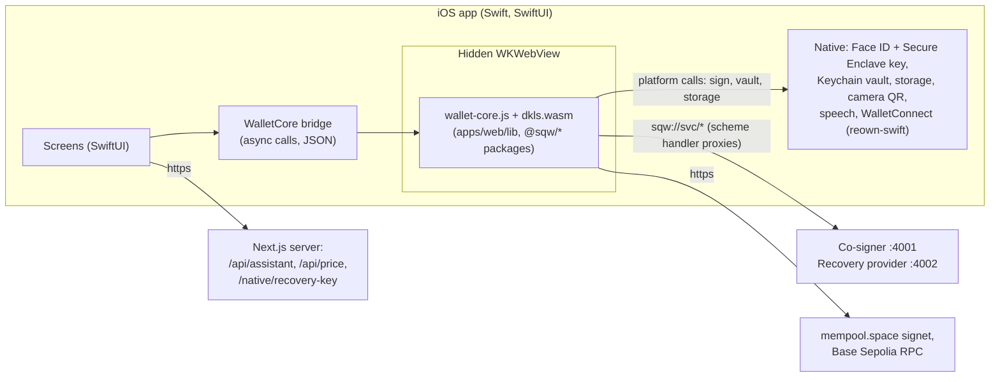

# Native iOS app: plan

Status: **every screen is in the app (steps 1 to 5). Tested in the Simulator through the phone's path (https tunnel): the core story, rules, alerts, attacker mode, Explore. Waiting on this Mac for: test coins and the original co-signer key (payments), the assistant's LLM key, the Reown project ID, and an iPhone with a signing account (step 6). See "On an iPhone" and "Test coins on the Mac".**
is the handoff for building the iOS app on the team Mac. It records the decisions taken on 2026-10-11 and how
each part of the web app maps to the native app.

## Decisions

| Question | Decision |
|---|---|
| Where | Built and tested on the team Mac with Xcode (Simulator first, then a device). Windows cannot build iOS. |
| Crypto | **Hybrid.** SwiftUI for every screen; native Face ID, Secure Enclave, Keychain, camera, speech, WalletConnect. The audited crypto and wallet protocol code (DKLs23, bitcoinjs-lib, viem, `@sqw/*`) runs unchanged in a hidden `WKWebView` inside the app: the **wallet core**. |
| Scope | Everything, screen by screen (1-to-1 with `apps/web`). The web app stays as the demo fallback until the native app has passed the full demo script. |
| Recovery key | The recovery-key step opens a web page (`/native/recovery-key`) from the app; the passkey or security key ceremony happens there and the result comes back to the app. |
| Services | Unchanged: the co-signer and the recovery provider are the same processes. The Next.js server keeps serving `/api/assistant` (the LLM key never reaches the phone), `/api/price`, the recovery-key page and the mock e-banking page. |

Why not a pure-Swift port of the crypto: CLAUDE.md forbids writing our own cryptography, there is no Swift
build of the exact DKLs23 library, and new shares must stay compatible with the shares the services hold. A
`WKWebView` runs WebAssembly; the plain JavaScriptCore framework on iOS does not, so the core lives in a web view.

## Architecture



- The web view loads `sqw://core/index.html` through a `WKURLSchemeHandler`. The same handler proxies
  `sqw://svc/cosigner/*` and `sqw://svc/recovery/*` to the services, as the Next.js rewrites do for the web app
  (no CORS, one place to configure the Mac's address).
- **One source of truth.** The core is bundled from the web app's own `lib/` with esbuild. Four modules are
  swapped for native-backed versions at bundle time: `passkey`, `vault`, `dkls` (wasm path) and `idb-keyval`
  (storage). The web app itself is not changed.

## Face ID (native)

- **Wallet passkey = a Secure Enclave P-256 key**, created with `SecureEnclave.P256.Signing.PrivateKey` and an
  access control of `.privateKeyUsage` + `.biometryCurrentSet`. Face ID is asked by the system at each use. A
  new face enrolled on the phone invalidates the key (the safe is then recovered like a lost phone).
- **Base payments keep working with the deployed contracts.** `RulebookAccount` uses OpenZeppelin's
  `WebAuthn.verify`, which checks the challenge, the user-present and user-verified flags and the signature, not
  the origin or the rpIdHash. The core builds a WebAuthn-format assertion (authenticatorData with UP and UV set,
  clientDataJSON with `"type":"webauthn.get"` and the challenge); the Secure Enclave signs
  `authenticatorData || SHA-256(clientDataJSON)` (CryptoKit hashes it with SHA-256); the existing
  `passkeySignature()` normalizes `s`. The `apps-check` live test already proved a non-browser P-256 key works.
- **Vault = Keychain.** Share 1 and the pocket key are stored as one Keychain item with
  `kSecAttrAccessibleWhenPasscodeSetThisDeviceOnly` and `.biometryCurrentSet`: reading it requires Face ID and the
  item never leaves the device or its backups. (Web app equivalent: AES-GCM with a key from the passkey's PRF.)
- `Info.plist`: `NSFaceIDUsageDescription`.

## Recovery key (web page)

The recovery key (hardware security key by default, or a synced passkey) is registered and used only with the
recovery provider, which verifies WebAuthn with `@simplewebauthn/server` against an origin and RP ID. The core
asks the app (`recoveryKey.register` / `recoveryKey.authenticate`, with the provider's options), and the app opens
[`/native/recovery-key`](../apps/web/app/native/recovery-key/page.tsx) in an `ASWebAuthenticationSession`
(callback scheme `sqwallet`):

- request: `http://<web app>/native/recovery-key#mode=register|authenticate&options=<base64url JSON>&state=<random>`;
- answer: `sqwallet://recovery-key#state=<same>&response=<base64url JSON>`, or `#state=<same>&error=<text>`
  (`error=cancelled` when the client cancels). The app checks `state` and returns `{ response }` to the core,
  which sends it to the provider unchanged.

Constraint to settle before testing on a device: WebAuthn needs `localhost` or an https **domain** (an IP address
is not allowed as RP ID). The Simulator reaches the Mac as `localhost`, so it works there as today. On a real
iPhone the page needs an https hostname for the Mac (a tunnel), set as `RP_ID` and in `APP_ORIGINS` of the
recovery provider. **Ask before starting a public tunnel.**

## Mapping: web app to iOS

| Web (`apps/web`) | iOS (`apps/ios/SwissquoteWallet`) |
|---|---|
| `app/layout.tsx`, `components/screen.tsx`, `tab-bar.tsx` | `App/SwissquoteWalletApp.swift`, `UI/Screen.swift`, `UI/TabBar.swift` (Home, Explore, Assistant, Send, Rules) |
| `app/globals.css`, `replica/design/tokens.json`, appearance | `UI/Theme.swift` (colour tokens, light and dark, background presets, Geist font bundled) |
| `app/login` | `Screens/LoginView.swift` (Mock login) |
| `app/onboarding`, `keyholders.tsx`, `plan-choice.tsx`, `recovery-key-setup.tsx` | `Screens/Onboarding/*` |
| `app/page.tsx`, `ask-box.tsx`, `tokens.tsx` | `Screens/HomeView.swift`, `UI/AskBox.swift`, `UI/TokenIcons.swift` |
| `app/send/*` | `Screens/Send/SendView.swift`, `BitcoinConfirmView.swift`, `UsdcConfirmView.swift`, sent views |
| `app/receive` | `Screens/ReceiveView.swift` (QR with Core Image) |
| `app/rules` | `Screens/RulesView.swift` (contacts, apps, limits, pending changes with countdown, screening card) |
| `app/activity`, `app/alerts`, `alerts-feed.tsx` | `Screens/ActivityView.swift`, `AlertsView.swift` |
| `app/assistant` | `Screens/AssistantView.swift` (speech: `SFSpeechRecognizer`, still labelled Mock of Swiss-hosted speech-to-text) |
| `app/explore`, `explore/[id]`, `app-confirm.tsx` | `Screens/Explore/*` (search, app page, swap and Aave panels, confirm and done) |
| `app/explore/scan`, `connect-overlay.tsx`, `lib/walletconnect.ts` | `Screens/Explore/ConnectAppView.swift` (camera QR with AVFoundation), `WalletConnect/*` (reown-swift WalletKit) |
| `app/recover`, `app/recovery-key` | `Screens/Recovery/*` (face check Mock, countdown, recovery key via the web page) |
| `app/settings`, `app/demo`, `app/demo/attacker` | `Screens/SettingsView.swift`, `Screens/Demo/*` |
| `app/e-banking` | Stays a web page: it is the client's *other* device (Mock). |
| `lib/*.ts` (wallet layer) | Runs in the wallet core; called through `Core/WalletCore.swift` |
| `lib/passkey.ts`, `lib/vault.ts`, `idb-keyval` | Native: `Native/FaceIdKey.swift` (Secure Enclave), `Native/Vault.swift` (Keychain), `Native/Storage.swift` |

## Wallet core API

`apps/ios-core` builds `wallet-core.js` + `dkls.wasm`. It exposes one function, `window.sqwCore.call(name, args)`,
returning JSON (bigints as decimal strings). Names mirror the web app's `lib` functions: `createSafe`,
`finishSetup`, `loadBalances`, `preparePayment`, `sendPayment`, `prepareUsdcPayment`, `sendUsdcPayment`,
`loadRulebook`, `requestChange`, `loadActivity`, `beginRecovery`, `completeRecovery`, `prepareAppUse`,
`sendAppUse`, `prepareDappTransaction`, `sendDappTransaction`, and the assistant's `resolveDraft` / `mergeAnswer`.
Prepared payments stay inside the core and are referred to by an id, so Swift never re-serializes a transaction.

The core calls back into Swift (`window.webkit.messageHandlers.native`) for: `faceId.create`,
`faceId.sign(message)`, `vault.save`, `vault.unlock` (Face ID), `vault.delete`, `storage.get/set/del`.

## Native side of the bridge (what Swift implements)

Calls from the core (`{ id, method, params }`), answered with `window.sqwNative.reply(id, ok, json)`:

| Method | Params | Answer | Native implementation |
|---|---|---|---|
| `faceId.create` | `label` | `{ keyId, publicKey }`: uncompressed P-256 point, hex (65 bytes) | `SecureEnclave.P256.Signing.PrivateKey` with `.privateKeyUsage, .biometryCurrentSet`; keep its `dataRepresentation` in the Keychain under `keyId` |
| `faceId.sign` | `keyId`, `message` (hex), `reason` | `{ signature }`: DER, hex | `signature(for: message)` (CryptoKit hashes with SHA-256), Face ID prompt with `reason` |
| `faceId.confirm` | `keyId`, `reason` | `{}` | `LAContext.evaluatePolicy(.deviceOwnerAuthenticationWithBiometrics)` |
| `vault.save` | `walletId`, `mpcShare`, `pocketKey` (hex) | `{}` | one Keychain item, `kSecAttrAccessibleWhenPasscodeSetThisDeviceOnly` + `.biometryCurrentSet` |
| `vault.unlock` | `walletId`, `reason` | `{ mpcShare, pocketKey }` | read that item (the Keychain shows Face ID) |
| `device.forget` | — | `{}` | delete the vault item and the Face ID keys ("Lose this phone") |
| `storage.get` / `storage.set` / `storage.del` | `key`, `value` (string) | `{ value }` / `{}` | `UserDefaults` (public data only) |
| `recoveryKey.register` / `recoveryKey.authenticate` | `options` | `{ response }` | `ASWebAuthenticationSession` with the page above |

One-way events from the core: `{ event: "keygen-progress" | "recovery-progress", data: { round, total } }`.
Swift calls the core with `callAsyncJavaScript("return await sqwCore.call(method, args)")`, `args` a JSON array
string, and decodes the JSON string it returns: `{ ok, value }` or `{ ok: false, error: { name, message, … } }`.
The methods are listed in [`apps/ios-core/src/api.ts`](../apps/ios-core/src/api.ts);
[`test/fake-native.ts`](../apps/ios-core/test/fake-native.ts) is a working reference for this table.

## Build order (each step works end to end before the next)

1. **Core: done.** `apps/ios-core`: `pnpm --filter @sqw/ios-core build` writes `dist/` (index.html,
   wallet-core.js, dkls.wasm) for the app bundle. `pnpm --filter @sqw/ios-core check` runs it in headless
   Edge/Chrome with a stand-in for the iOS side, against `pnpm dev`. Passed on 2026-10-11: MPC key generated in
   about 3 s, Swissquote registered the safe and verified both ownership proofs, balances and rules read, and a
   USDC 0.10 payment to Léo signed by Face ID alone, in the Secure Enclave's format, was accepted on Base
   ([`0x609f126b…`](https://sepolia.basescan.org/tx/0x609f126b91d427591770e5bc3f214c13d218ba87896af70ee0658535c07587c4)).
   The recovery-key page is in place (`/native/recovery-key`).
2. **Xcode project: done.** `apps/ios/SwissquoteWallet.xcodeproj` (folder-synchronized: new Swift files under
   `apps/ios/SwissquoteWallet/` are picked up without editing the project). A build phase copies
   `apps/ios-core/dist` into the bundle as `core/`. Check, passed on 2026-10-11 in the iOS 27 Simulator (iPhone 17,
   Xcode 27.0) against `pnpm dev`: core loaded in a secure context (50 methods), Face ID created the Secure Enclave
   key, 2-of-3 MPC key generated in 1.1 s, Swissquote verified the ownership proof with the vault opened by Face ID,
   balances and rules read, "Lose this phone" forgot everything. Run it again:

   ```sh
   pnpm dev                                   # services on the Mac
   pnpm --filter @sqw/ios-core build          # the core, copied into the app at build time
   cd apps/ios && xcodebuild -project SwissquoteWallet.xcodeproj -scheme SwissquoteWallet \
     -destination 'platform=iOS Simulator,name=iPhone 17' -derivedDataPath build/DerivedData build
   xcrun simctl install "iPhone 17" build/DerivedData/Build/Products/Debug-iphonesimulator/SwissquoteWallet.app
   xcrun simctl launch --console-pty "iPhone 17" ch.swissquote.wallet.prototype -bridgeCheck   # prints CHECK lines
   ```

   Face ID in the Simulator: Features > Face ID > Enrolled, then Matching Face at each prompt (or
   `xcrun simctl spawn "iPhone 17" notifyutil -p com.apple.BiometricKit_Sim.pearl.match`).
3. **Core story**: login, onboarding, home, Bitcoin send (pocket and Savings), receive, recovery, and the part of
   the Demo panel the core story needs (Swissquote offline, Lose this phone). Screens of later steps say so
   plainly and link to the web app. UI tests (`apps/ios/SwissquoteWalletUITests`) drive the real screens:

   ```sh
   apps/ios/scripts/ui-test.sh "iPhone 17" -only-testing:SwissquoteWalletUITests/WalletUITests/testCoreStory
   apps/ios/scripts/ui-test.sh "iPhone 17" -only-testing:SwissquoteWalletUITests/WalletUITests/testPayments
   ```

   `testCoreStory` **passed on 2026-10-11** (about 2 min 15 s): Act 1 (log in, Face ID, MPC key, Swissquote's
   ownership check, recovery passkey through `/native/recovery-key`, Premium, home "Verified yours"), Receive
   (QR code), Act 4 step 1 (Swissquote offline shown on Home, then back), Act 5 (Lose this phone, new Face ID
   key, recovery passkey, Mock face check, 60 s waiting period, MPC refresh, **same Savings safe address**).
   `testPayments` (Act 1 transfers, Act 2 Bitcoin payments, Act 4 offline payments with the recovery key) needs
   test bitcoin in Swissquote's demo account: not run yet on this Mac.
4. **USDC on Base, rules, activity, alerts, settings, attacker mode: done.** `testRulesAttackerAndAlerts`
   passed through the tunnel: a new contact is screened by Swissquote, waits and is cancelled; freeze is
   instant, unfreeze waits; Alerts cancels a request; plan Standard and back; Attacker mode stops the CHF 5,000
   payment (BLOCKED in bitcoin and USDC) and the recovery to the thief's phone. USDC payments themselves wait
   for the original co-signer key (see "Test coins on the Mac").
5. **Assistant, Explore, Uniswap and Aave, WalletConnect: done.** The assistant's turn runs in the core
   (`apps/ios-core/src/assistant.ts`, the web page's own logic); voice is Apple's speech recognition, on the
   phone when the language allows (Mock of Swiss-hosted speech-to-text). Explore reads the catalogue from the
   core. WalletConnect uses reown-swift 2.4.0 (`ReownWalletKit`) and CryptoSwift 1.10.0 (keccak-256) as Swift
   packages; its relay socket is `URLSessionWebSocketTask`, and its keys use the app's own Keychain group (a
   free Apple account has no App Groups). Sessions: Base Sepolia only; requests: `eth_sendTransaction` only,
   prepared and checked by Swissquote, confirmed with Face ID; message signatures refused. Needs
   `NEXT_PUBLIC_REOWN_PROJECT_ID`; the assistant needs `LLM_API_KEY` (or `HF_TOKEN`).
6. Device run, README and demo script updates, commit.

## On an iPhone

The phone reaches the Mac through an https tunnel to the Next.js server, which forwards `/svc/cosigner` and
`/svc/recovery` to the two services. The recovery key needs https and a real host name, which the tunnel gives.

```sh
apps/ios/scripts/tunnel.sh        # Cloudflare quick tunnel to :3000; prints https://….trycloudflare.com and
                                  # writes RP_ID, APP_ORIGINS and DEV_ORIGINS into .env. Anyone with the URL can
                                  # reach the (Mock) services while it runs: stop it with Ctrl+C after the demo.
pnpm phone                        # restart the services (they read .env at start); the web part runs as a
                                  # production build: Next's dev server does not load reliably through a tunnel
pnpm --filter @sqw/ios-core build
apps/ios/scripts/device.sh TEAM_ID https://….trycloudflare.com
```

`device.sh` builds with your Apple team (Xcode > Settings > Accounts; a free account works, the app then lasts 7
days), installs on the connected iPhone (cable, "Trust this computer", Developer Mode on) and starts it against
the tunnel. The address can also be changed in the app: Hackathon prototype > Swissquote services. A new tunnel
has a new name, and recovery keys are tied to the name they were added under: keep one tunnel for a whole demo.

## Verified on the Mac (2026-10-11)

- **Tools:** macOS 26.6.2 (Apple silicon), Xcode 27.0 (27A266a), iOS 27.0 Simulator runtime. Node 24 and pnpm
  10.18.0 (through corepack). The project targets iOS 18 and later.
- **reown-swift (WalletKit):** latest release **2.4.0** (2026-09-14), products `ReownWalletKit` and
  `WalletConnect`, iOS 13 and later. Pin exactly 2.4.0 when step 5 adds it (Swift Package Manager).
- **Secure Enclave in the Simulator:** available (`SecureEnclave.isAvailable` is true, a plain key creates and
  signs), but **a key or Keychain item bound to Face ID is refused** (`.biometryCurrentSet`, `.biometryAny` and
  `.userPresence` all fail with LocalAuthentication -1020, "not supported on iOS Simulator"). So the Simulator
  build uses a plain Secure Enclave key and a plain this-device-only Keychain item, and the app asks Face ID
  (`LAContext`) before each use; the check screen says so. On a device the Secure Enclave and the Keychain
  enforce Face ID themselves. Same signature format either way.
- **Network:** the Simulator shares the Mac's network, so `localhost` reaches the services. `Info.plist` sets
  `NSAllowsLocalNetworking` (plain http on the local network). The app has one server address, the Next.js
  server (build setting `SQW_SERVER_URL`, default `http://localhost:3000`, changeable in the Demo panel), which
  forwards `/svc/*` to the services. The scheme handler serves the core at `sqw://core/` and proxies
  `/svc/cosigner/`, `/svc/recovery/` and `/api/` (the core calls `/api/price` itself) so the core sees one
  origin. mempool.space and sepolia.base.org answer CORS for the `sqw://core` origin. A device uses the https
  tunnel (see "On an iPhone"): the EPFL network does not let devices reach each other, and the recovery key
  needs an https name.

- **Recovery key in the Simulator:** works with the synced-passkey option. `ASWebAuthenticationSession` opens
  `/native/recovery-key` (ephemeral, no consent alert), the page's button brings the system sheet ("Save a
  passkey?" → Add Passkey, or sign in with it), Face ID, and the answer comes back at `sqwallet://`. iOS logs
  that http in `ASWebAuthenticationSession` is deprecated: fine on `localhost`, but a device needs the https
  name anyway. Right after a Face ID prompt the app is briefly inactive and the session refuses to start
  (`presentationContextInvalid`, error 3): `RecoveryKeySession` waits until the app is active again.

## Test coins on the Mac

The co-signer creates its own hot wallet (Swissquote's demo account and Base relayer) in
`services/cosigner/cosigner.db` on first start. On this Mac that is a **new, empty** key
(`tb1q2vxf4xg97rswl6ju24u0ktrcfd3cawpt3r49z0`, `0x046c107047BA7bD43FB665C0132B2Eddcd5edD37`), while the deployed
`SwissquotePaymaster` (`0x325A…ABbB`) only accepts sponsorships signed by the original machine's key
(`signer()` = `0xfd0108f7f5bbb4c35ef5d7021b08f62d6ce3df97`). So on this Mac: no Mock transfers until the demo
account has test bitcoin, and **no USDC payments on Base** until the co-signer uses the original key. Fix: copy
`services/cosigner/cosigner.db` from the machine that deployed the contracts (it is git-ignored; keep it private:
it holds Swissquote's Mock share of every safe opened there). Safes opened on that machine cannot be recovered
here (their recovery-provider share stays there); new safes are fine. That machine's `.env` also has the values
this Mac lacks: `LLM_API_KEY` (or `HF_TOKEN`) for the assistant and `NEXT_PUBLIC_REOWN_PROJECT_ID` for
WalletConnect.
